# AKAP11 RNA-seq reanalysis: from FASTQ to pathways

**BINF 5240 Bioinformatics Computing: course project**


This project reanalyzes bulk RNA-seq data from human iPSC-derived neurons: three heterozygous **AKAP11 knockout** clones (KO) and three **wild-type** replicates (WT). It starts from the raw FASTQ files and goes all the way to differential expression, pathway analysis and an **automatic comparison with the published paper**, including redrawn versions of the paper's figures.

| | |
|---|---|
| **Data**  | [GEO GSE263847](https://www.ncbi.nlm.nih.gov/geo/query/acc.cgi?acc=GSE263847), BioProject PRJNA1099597. 6 paired-end samples, Illumina NovaSeq 6000  |
| **Paper**  | Farhangdoost N. *et al.* (2025) *Molecular Psychiatry* 30:4543–4557, [doi:10.1038/s41380-025-03040-x](https://doi.org/10.1038/s41380-025-03040-x)  |
| **Part 1**  | FASTQ → gene counts with nf-core/rnaseq 3.19.0 (STAR + Salmon) on SDSC Expanse |
| **Part 2**  | Gene counts → results with Python (PyDESeq2, GSEApy, Reactome ORA) |

> **Main result:** the reanalysis reproduces the paper closely. It finds **848 significant genes** against the paper's 849. All 55 of the paper's top 60 genes that are present in this dataset change **in the same direction** (fold-change correlation **r = 0.98**). The same biology comes out: **GPCR signalling** leads the Reactome analysis, and **ribosome and translation genes go down** in the knockout in GSEA.

---

## Contents

1. [Background](#background)
2. [Quick start](#quick-start)
3. [Repository layout](#repository-layout)
4. [Part 1: FASTQ to gene counts (Expanse)](#part-1-fastq-to-gene-counts-expanse)
5. [Part 2: gene counts to results (Python)](#part-2-gene-counts-to-results-python)
6. [What each step does, and why](#what-each-step-does-and-why)
7. [Results](#results)
8. [Comparison with the paper](#comparison-with-the-paper)
9. [Reproducing the paper's figures](#reproducing-the-papers-figures)
10. [Output files](#output-files)
11. [Settings](#settings)
12. [Reading the code](#reading-the-code)
13. [How this project meets the assignment](#how-this-project-meets-the-assignment)
14. [Using the code with another dataset](#using-the-code-with-another-dataset)
15. [Limitations and notes](#limitations-and-notes)
16. [Software versions](#software-versions)
17. [Citation and data sources](#citation-and-data-sources)

---

## Background

*AKAP11* (A-kinase anchoring protein 11) anchors protein kinase A (PKA) and GSK3β. Rare loss-of-function variants in *AKAP11* are among the strongest known genetic risk factors for **bipolar disorder and schizophrenia**. Farhangdoost *et al.* used CRISPR to make heterozygous *AKAP11* knockout iPSC lines, turned them into neurons, and measured gene expression (RNA-seq) and DNA methylation.

This project asks: **starting from the same raw reads but with a different, modern pipeline, do we reach the same conclusions?**

| Sample | Group | GEO | SRA run |
|---|---|---|---|
| AKAP11_KO_clone16 | KO | GSM8200086 | SRR28641569 |
| AKAP11_KO_clone20 | KO | GSM8200087 | SRR28641568 |
| AKAP11_KO_clone21 | KO | GSM8200088 | SRR28641567 |
| WT_rep1 | WT | GSM8200089 | SRR28641566 |
| WT_rep2 | WT | GSM8200090 | SRR28641565 |
| WT_rep3 | WT | GSM8200091 | SRR28641564 |

---

## Quick start

The gene counts from Part 1 are already in the repository, so Part 2 can be run on any computer:

```bash
# 1. Get the code
git clone https://github.com/Aaliahaly/AKAP11-RNAseq-Reanalysis.git
cd AKAP11-RNAseq-Reanalysis

# 2. Install the Python packages (Python 3.12 or newer)
python3 -m pip install -r requirements.txt

# 3. Run the whole analysis (about 6 to 10 minutes)
python3 run_analysis.py AKAP11_final_gene_counts_length_scaled.tsv samples.tsv WT KO akap11_go_bp_results AKAP11
```

When it prints `Results saved in akap11_go_bp_results`, open:

- `akap11_go_bp_results/11_comparison_with_paper.md`: the automatic comparison with the paper
- `akap11_go_bp_results/12_paper_figures_report.md`: each paper figure, what was reproduced, and why anything differs

> [!NOTE]
> GSEA downloads gene sets from Enrichr, so the run needs internet. To run offline, set `gsea_gene_sets = "go_biological_process.gmt"` in `settings.py`. The paper-style GSEA for Fig. 2F needs internet in all cases; without it, that one panel is skipped and everything else still runs.

---

## Repository layout

```text
RNAseq_Small_Steps/
├── README.md                     this file
├── requirements.txt              Python packages to install
├── .gitignore
│
├── docs/
│   ├── 01_fastq_to_counts.md     Part 1: the full Expanse workflow, step by step
│   └── AKAP11_Expanse_Workflow_Final.docx   the same guide as a Word file
│
├── run_analysis.py               START HERE: runs every step in order
├── settings.py                   every cutoff and option, in one place
├── read_counts.py                step 1: read, check and filter the data
├── fit_model.py                  step 2: differential expression (PyDESeq2)
├── plot_pca.py                   step 3: PCA and sample correlations
├── plot_volcano.py               step 4: volcano plot
├── plot_ma.py                    step 4: MA plot
├── plot_expression_heatmap.py    step 5: heatmap of the top genes
├── plot_target_gene.py           step 6: one gene across all samples
├── run_gsea.py                   step 7: GSEA
├── plot_pathways.py              step 8: GSEA bar plot
├── run_ora.py                    step 9: Reactome over-representation analysis
├── plot_ora.py                   step 10: ORA bar plot
├── run_paper_gsea.py             step 11: a second GSEA set up like the paper's Fig. 2F
├── compare_to_paper.py           step 12: automatic check against the paper
├── plot_paper_figures.py         step 13: redraws the paper's figures, explains differences
├── save_plot.py                  helper that saves every figure the same way
│
├── AKAP11_final_gene_counts_length_scaled.tsv   input: gene counts from Part 1
├── samples.tsv                                  input: sample sheet
├── go_biological_process.gmt                    GO Biological Process (offline copy)
├── reactome_human.gmt                           Reactome pathways
├── paper_reference/                             values copied from the paper's Figs. 1 and 2
└── akap11_go_bp_results/                        results of the run described below
```

---

## Part 1: FASTQ to gene counts (Expanse)

The full, step-by-step guide is in **[docs/01_fastq_to_counts.md](docs/01_fastq_to_counts.md)**, with every command, the Slurm scripts, expected outputs, job IDs and a troubleshooting section. This is a summary.

### Why nf-core/rnaseq with STAR + Salmon suits this data

| Property of the data | What the pipeline needs | How nf-core/rnaseq handles it |
|---|---|---|
| Bulk, short-read, paired-end Illumina | A bulk pipeline ending in one count per gene per sample | Built for exactly this; peer-reviewed and versioned (3.19.0) |
| Spliced mRNA, human genome available | A splice-aware aligner | **STAR**, the same aligner the paper used |
| Many reads match several transcripts | A way to share ambiguous reads | **Salmon** shares them out; the paper's HTSeq discards them |
| Strandedness not stated on GEO | Automatic detection | `strandedness: auto`, confirmed by RSeQC (all reverse) |
| 145 to 294 million read pairs per sample | Cluster execution with restarts | Nextflow on Slurm, Singularity containers, `-resume` |
| Need to trust the data first | Built-in QC | FastQC, Trim Galore, Qualimap, RSeQC, dupRadar, featureCounts, MultiQC |

### The steps

| Step | What happens |
|---|---|
| 1 | Log in to Expanse and set up the project folders |
| 2 | Download GRCh38 (primary assembly) and the GENCODE v47 annotation |
| 3 | Get the run table from ENA and the sample titles from GEO |
| 4 | Download the 6 SRA runs and convert them to FASTQ (Slurm array job) |
| 5 | Write the nf-core sample sheet |
| 6 | Configure Nextflow for Slurm and Singularity |
| 7 | Test the pipeline with the nf-core test profile |
| 8 | Run the pipeline on the six samples |
| 9–12 | Monitor the run, find the results, copy the counts and the MultiQC report to the laptop |

The main pipeline command (step 8):

```bash
nextflow run nf-core/rnaseq \
    -r 3.19.0 \
    -profile singularity \
    -c configs/expanse.config \
    -c configs/readdup_72g.config \
    --input metadata/samplesheet.csv \
    --outdir results/rnaseq_with_readdup \
    --fasta reference/gencode_v47/GRCh38.primary_assembly.genome.fa \
    --gtf reference/gencode_v47/gencode.v47.primary_assembly.annotation.gtf \
    --aligner star_salmon \
    --save_reference \
    --max_cpus 16 --max_memory '120.GB' --max_time '12.h' \
    --rseqc_modules bam_stat,inner_distance,infer_experiment,junction_annotation,junction_saturation,read_distribution,read_duplication \
    --featurecounts_group_type gene_type \
    -resume
```

The output used in Part 2 is `salmon.merged.gene_counts_length_scaled.tsv`, renamed here to `AKAP11_final_gene_counts_length_scaled.tsv`.

### Quality control (MultiQC)

| Measure | KO 16 | KO 20 | KO 21 | WT 1 | WT 2 | WT 3 |
|---|---|---|---|---|---|---|
| Read pairs (millions) | 165.1 | **293.8** | 155.4 | 179.6 | 153.7 | 145.0 |
| Uniquely mapped (STAR) | 96.1% | 95.7% | 95.5% | 94.1% | 95.5% | 95.7% |
| Strandedness | reverse | reverse | reverse | reverse | reverse | reverse |
| Intronic reads (Qualimap) | 30.9% | **56.4%** | 36.2% | 34.4% | 31.4% | 30.2% |
| Duplicate reads, read 1 (FastQC) | 38.0% | **67.1%** | 37.5% | 36.1% | 38.0% | 36.3% |
| Protein-coding reads | 95.3% | 93.9% | 94.7% | 95.5% | 95.2% | 94.7% |
| rRNA reads | < 0.001% | < 0.001% | < 0.001% | < 0.001% | < 0.001% | < 0.001% |

**Overall the data is good:** more than 94% unique mapping in every sample and almost no rRNA. **Clone 20 stands out**: it has twice the depth, many more intronic reads (likely more unspliced pre-mRNA) and higher duplication. It was kept, because it passes the basic checks and the paper used all three clones, but it is the main caveat when reading the results.

---

## Part 2: gene counts to results (Python)

### 1. Install

You need Python 3.12 or newer. From the project folder:

```bash
python3 -m pip install -r requirements.txt
```

### 2. Check the inputs

**The count table** (`AKAP11_final_gene_counts_length_scaled.tsv`) is tab-separated, with a `gene_id` column, a `gene_name` column, and one column per sample.

**The sample sheet** (`samples.tsv`) is tab-separated, with a `sample` column and a `condition` column. Sample names must match the count table's column headings exactly. Extra columns are ignored.

```tsv
sample	condition	geo_sample	sra_run
AKAP11_KO_clone16	KO	GSM8200086	SRR28641569
AKAP11_KO_clone20	KO	GSM8200087	SRR28641568
AKAP11_KO_clone21	KO	GSM8200088	SRR28641567
WT_rep1	WT	GSM8200089	SRR28641566
WT_rep2	WT	GSM8200090	SRR28641565
WT_rep3	WT	GSM8200091	SRR28641564
```

### 3. Run

```bash
python3 run_analysis.py AKAP11_final_gene_counts_length_scaled.tsv samples.tsv WT KO akap11_go_bp_results AKAP11
```

| Argument | Meaning |
|---|---|
| `AKAP11_final_gene_counts_length_scaled.tsv` | the count table |
| `samples.tsv` | the sample sheet |
| `WT` | the reference group |
| `KO` | the comparison group. A positive log2 fold change means higher in KO |
| `akap11_go_bp_results` | the results folder (created if it doesn't exist) |
| `AKAP11` | *optional*: one gene to plot on its own |

Some warnings print along the way; that's normal. The run is finished when it prints `Results saved in akap11_go_bp_results`.

### 4. Rerun only the comparison or the figures

Both scripts read everything from the results folder, so they can be rerun on their own in a few seconds:

```bash
python3 compare_to_paper.py akap11_go_bp_results
python3 plot_paper_figures.py akap11_go_bp_results
```

---

## What each step does, and why

| Step | File | Method | Why |
|---|---|---|---|
| 1 | `read_counts.py` | Round counts to whole numbers; keep genes with ≥ 10 counts in ≥ 3 samples (26,288 of 78,932 genes) | Removes genes with too few reads to test. Requiring 3 samples (one group's size) keeps genes switched on in only one group |
| 2 | `fit_model.py` | PyDESeq2, design `~condition`, Wald test, Benjamini–Hochberg; significant = padj ≤ 0.05 and \|log2FC\| ≥ 1 | DESeq2 models count data, corrects for sequencing depth and shares variance information across genes, which matters with only 3 replicates |
| 3 | `plot_pca.py` | PCA of log2(CPM + 1); Pearson correlations of VST expression | Checks that samples group by genotype and finds outliers |
| 4 | `plot_volcano.py`, `plot_ma.py` | Fold change vs adjusted p-value, and vs mean count | Shows the size and strength of the changes |
| 5 | `plot_expression_heatmap.py` | Row z-scores of the top 25 significant genes | Shows that the changes are consistent across replicates |
| 6 | `plot_target_gene.py` | Normalized counts of one gene | Checks the knocked-out gene itself |
| 7–8 | `run_gsea.py`, `plot_pathways.py` | GSEApy prerank on **all** genes ranked by the Wald statistic; GO Biological Process; 1,000 permutations, seed 42 | Finds gene sets that shift together, even when single genes change only a little |
| 9–10 | `run_ora.py`, `plot_ora.py` | Hypergeometric test of the significant genes against Reactome, with all tested genes as background; BH correction | Repeats the paper's Fig. 2E |
| 11 | `run_paper_gsea.py` | A second GSEA with GO Molecular Function and gene sets up to 3,000 genes | Matches the paper's Fig. 2F, which includes very large terms |
| 12 | `compare_to_paper.py` | Checks the results against tables copied from the paper | Automates the comparison with the original authors |
| 13 | `plot_paper_figures.py` | Redraws each panel of the paper's Figs. 1 and 2 and explains every difference | Shows panel by panel what was reproduced |

---

## Results

### Samples group by genotype, with clone 20 apart

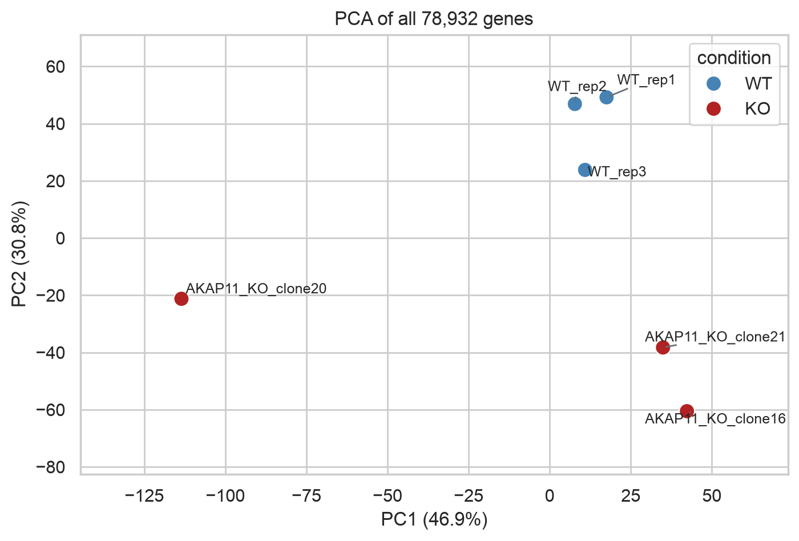

WT and KO samples separate, but clone 20 sits on its own along PC1. This matches its QC differences (depth, intronic reads), so the largest source of variation here is technical, in one sample.

### 848 significant genes

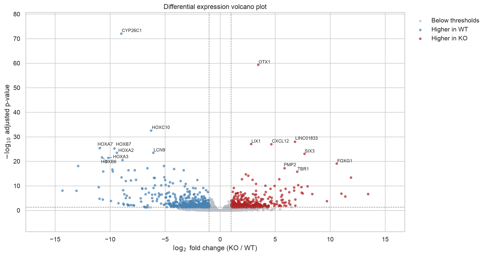

475 genes are lower and 373 higher in the knockout. The strongest changes include *CYP26C1*, several *HOX* genes and *OTX1*, genes involved in developmental patterning.

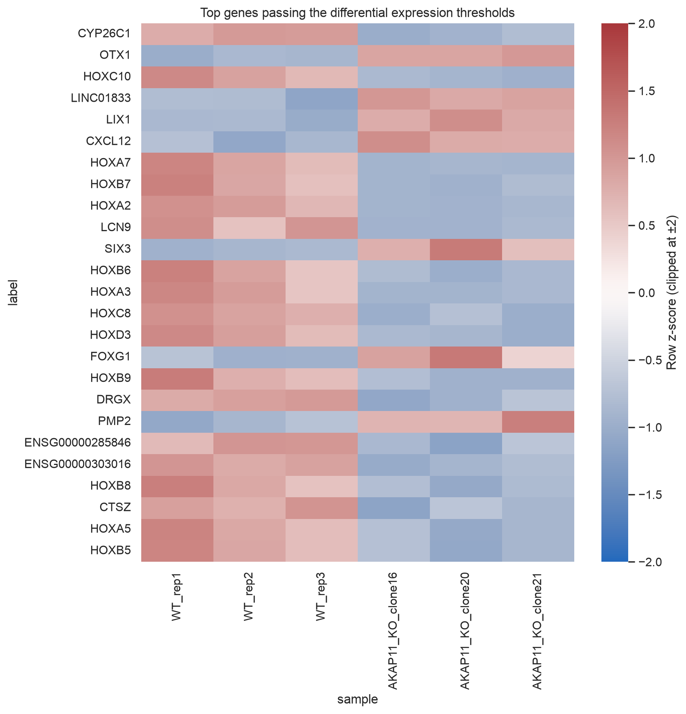

### AKAP11 itself

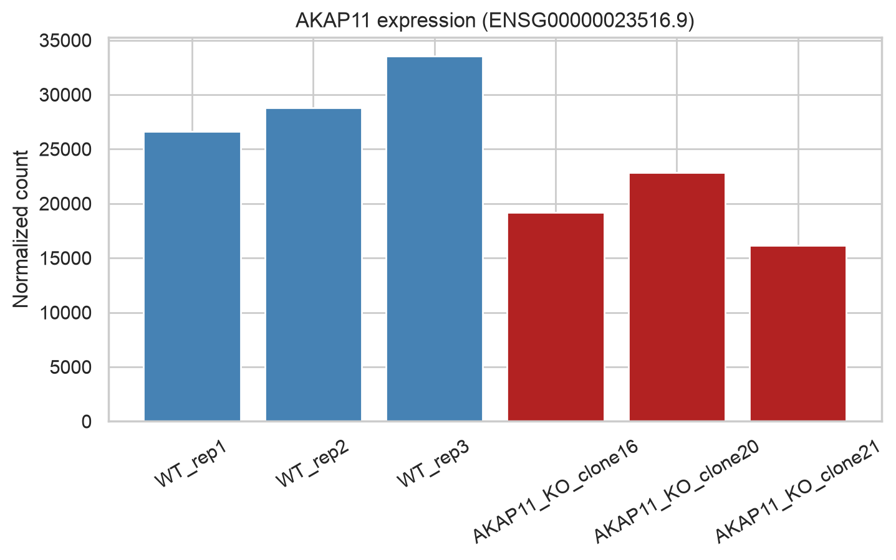

*AKAP11* is about 35% lower in the knockout (log2FC −0.61, padj 0.15). That doesn't pass the cutoffs, which fits a **heterozygous** knockout: one working copy remains, and the edited copy is still transcribed (see Fig. 1B below).

### GSEA: protein synthesis goes down

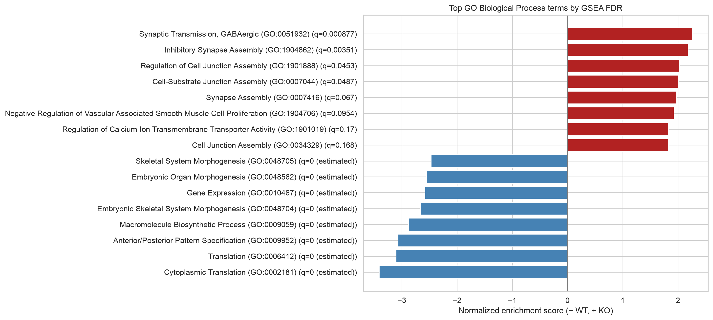

The most significant terms lower in KO are *cytoplasmic translation* and *translation* (NES −3.4 and −3.1), along with 14 other ribosome/translation terms. No such term goes up. This is the paper's main GSEA finding.

### Reactome ORA: GPCR signalling leads

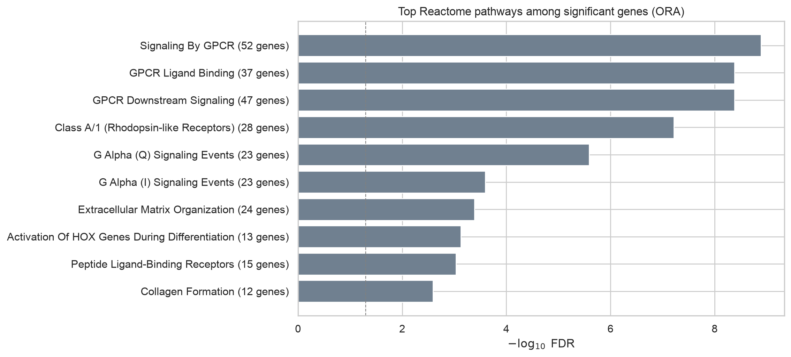

The top five pathways are all GPCR signalling (*Signaling by GPCR*, *GPCR ligand binding*, *G alpha (q)* and others), followed by extracellular matrix and collagen pathways, as in the paper.

---

## Comparison with the paper

`compare_to_paper.py` runs automatically at the end of every run. It reads small tables in [`paper_reference/`](paper_reference/) that were copied from the paper's figures, and writes `11_comparison_with_paper.md`.

| Check | Paper | This analysis | Verdict |
|---|---|---|---|
| Significant genes (Fig. 2B) | 849 (421 down, 428 up) | 848 (475 down, 373 up) | **similar** |
| Paper's top 60 genes (Fig. 2D) | — | 55 present; **all 55 same direction**; 37 significant; r = 0.98 | **agree** |
| Reactome ORA (Fig. 2E) | GPCR signalling, ECM | 7 of the paper's top 10 significant; GPCR pathways are our top 5 | **agree** |
| GSEA (Fig. 2F) | Ribosome/protein synthesis down in KO | 16 such terms significantly down, 0 up | **agree** |

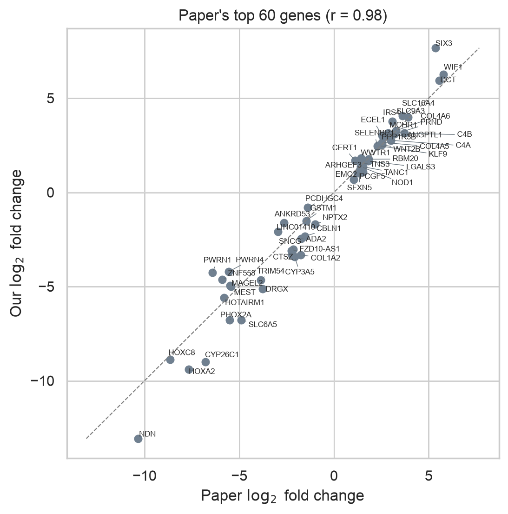

**Verdict rules** (written in `compare_to_paper.py`): totals within 20% → similar; ≥ 80% of genes in the same direction → agree; ≥ 70% of the paper's ORA pathways significant → agree; ribosome terms mostly down → agree.

**Missing genes:** five of the paper's top 60 genes aren't in this dataset. C5orf17, ZBED6CL, C9orf64 and LINC02302 were renamed between Ensembl 104 (paper) and GENCODE v47 (here); for example, C9orf64 is now *QNG1*. FRG1DP has zero reads in all six samples.

**Paper-style GSEA (GO Molecular Function):** 7 of the paper's 20 Fig. 2F terms are in our results, and all 7 change in the same direction. rRNA binding, tRNA binding and aminoacyl-tRNA ligase activity are significantly lower in KO.

### Why the numbers aren't identical

| Step | Paper | This project |
|---|---|---|
| Trimming | Trimmomatic | Trim Galore (nf-core/rnaseq) |
| Alignment | STAR | STAR |
| Counting | HTSeq, Ensembl 104 | Salmon + tximport, GENCODE v47 |
| Gene filter | mean count ≥ 20 (23,590 genes) | ≥ 10 counts in ≥ 3 samples (26,288 genes) |
| Differential expression | limma-voom, robust fit | PyDESeq2 |
| GSEA | fgsea, GO Molecular Function | GSEApy, GO Biological Process (main) and GO Molecular Function (Fig. 2F) |
| ORA | ShinyGO 0.77, curated Reactome | Hypergeometric test, Reactome `.gmt` |

---

## Reproducing the paper's figures

`plot_paper_figures.py` redraws every panel that can be made from RNA-seq data and writes `12_paper_figures_report.md`, which explains each difference.

| Panel | Our file | Status | Main reason for any difference |
|---|---|---|---|
| Fig. 1B, AKAP11 per clone | `12_fig1B_akap11_relative.png` | Reproduced with differences | RNA-seq counts the whole gene, including the edited copy; the paper's qPCR measures only the targeted exon 7. Both show AKAP11 lower in every clone and highest in clone 20 |
| Fig. 1C, Western blot | — | Not reproducible from RNA-seq | Measures protein |
| Fig. 1D, immunostaining | — | Not reproducible from RNA-seq | Microscope images |
| Fig. 2A, volcano plot | `12_fig2A_volcano.png` | Reproduced with differences | DESeq2 gives much smaller p-values for the strongest genes than limma-voom's robust fit (y-axis up to ~72 vs ~7) |
| Fig. 2B, DEG counts | `12_fig2B_deg_counts.png` | Reproduced with differences | Same total (848 vs 849); genes near the cutoffs split differently |
| Fig. 2C, heatmap | `12_fig2C_heatmap.png` | Reproduced | Two clean blocks; clone 20 follows the shared pattern least closely, as in the paper |
| Fig. 2D, top 30 genes | `12_fig2D_top_genes.png` | Reproduced with differences | The two methods rank the strongest genes differently |
| Fig. 2E, Reactome ORA | `10_reactome_ora.png` | Reproduced with differences | Same leading GPCR pathways; different Reactome version and background |
| Fig. 2F, GSEA GO MF | `12_fig2F_gsea_go_mf.png` | Reproduced with differences (needs internet) | GSEApy with 1,000 permutations can't report FDRs below ~0.001; fgsea can |
| Fig. 3, DNA methylation | — | Not reproducible from RNA-seq | A different experiment (WGBS) with its own data |

<table>
<tr>
<td>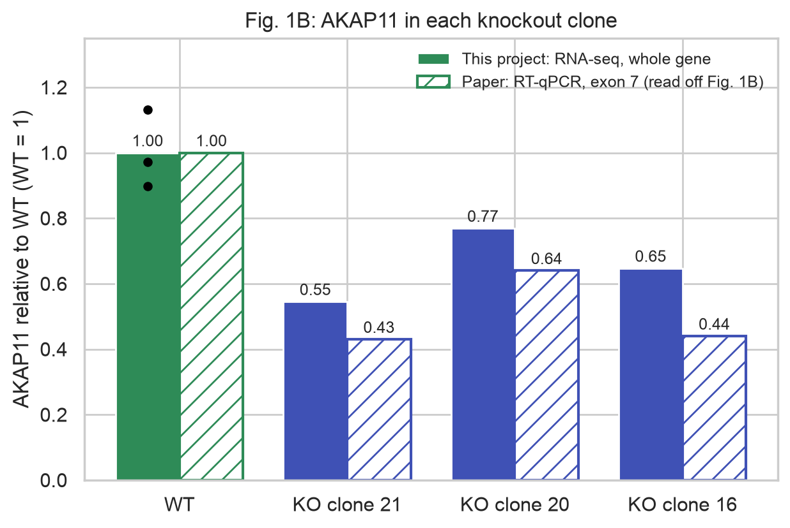</td>
<td>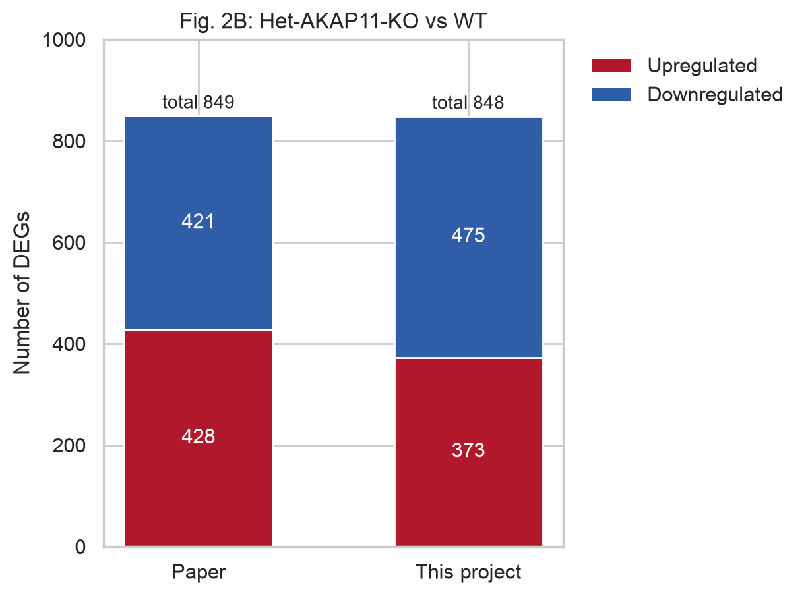</td>
</tr>
<tr>
<td>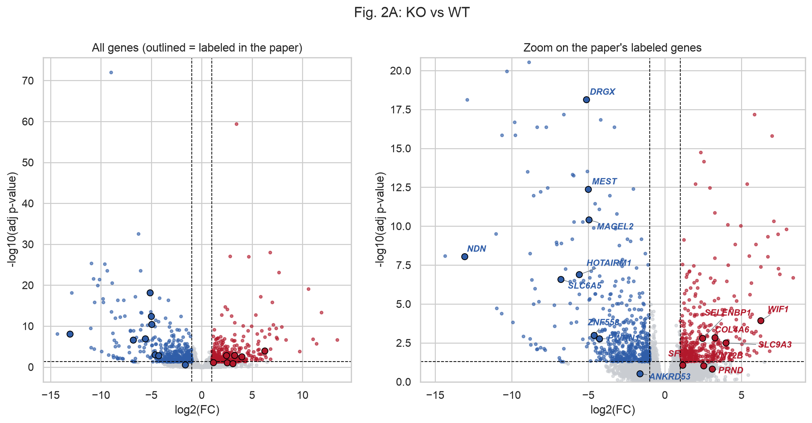</td>
<td>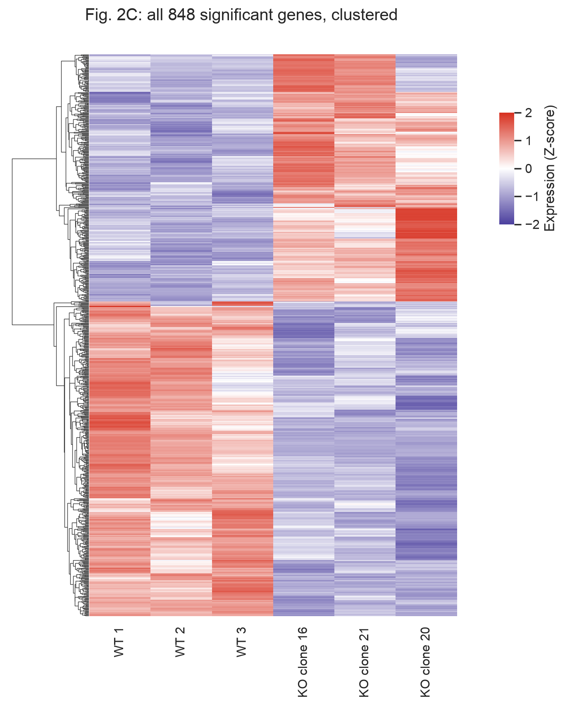</td>
</tr>
</table>

---

## Output files

All files are written to the results folder, numbered by step.

| File | Contents |
|---|---|
| `01_sample_qc.tsv` | Counts per sample, detected genes, DESeq2 size factors |
| `02_differential_expression.tsv` | Every tested gene: log2 fold change, p-value, adjusted p-value, direction |
| `02_significant_genes.tsv` | Genes passing both cutoffs |
| `02_normalized_counts.tsv`, `02_vst_expression.tsv` | Normalized counts and variance-stabilized expression |
| `03_pca.png`, `03_pca_scores.tsv` | Sample PCA |
| `04_sample_correlation.png` | Sample-to-sample correlations |
| `05_volcano.png`, `05_volcano_labels.tsv` | Volcano plot and its labeled genes |
| `06_ma.png` | MA plot |
| `07_de_heatmap.png` | Heatmap of the top significant genes |
| `08_target_gene.png`, `08_target_gene_results.tsv` | The optional gene |
| `09_gsea_gene_ranking.rnk` | The ranked gene list used for GSEA |
| `09_gsea_pathways.tsv`, `09_gsea_pathways.png` | GSEA results. Positive NES = higher in KO |
| `10_reactome_ora.tsv`, `10_reactome_ora.png` | Reactome ORA results |
| `11_comparison_with_paper.md` | **Short report comparing these results with the paper** |
| `11_paper_gene_comparison.tsv` | The paper's top 60 genes, gene by gene |
| `11_paper_term_comparison.tsv` | The paper's pathways and GO terms, term by term |
| `11_paper_vs_our_fold_change.png` | The paper's fold changes vs ours |
| `12_paper_figures_report.md` | **Every paper panel: what was reproduced, and why anything differs** |
| `12_fig1B_…` to `12_fig2F_…` | The paper's panels redrawn from these results |

---

## Settings

Every cutoff and option is in [`settings.py`](settings.py), each with a comment. No other file needs editing.

| Setting | Default | What it controls |
|---|---|---|
| `min_count`, `min_samples` | 10, `None` (= smaller group size) | Keep a gene with ≥ `min_count` counts in ≥ `min_samples` samples |
| `fdr_cutoff` | 0.05 | Maximum adjusted p-value for a significant gene |
| `fold_change_cutoff` | 1.0 | Minimum absolute log2 fold change (1 = twofold) |
| `volcano_labels` | 8 | Gene names shown on each side of the volcano plot |
| `heatmap_genes` | 25 | Genes in the heatmap |
| `gsea_gene_sets` | `"GO_Biological_Process_2025"` | GSEA collection (an Enrichr name or a local `.gmt`) |
| `gsea_collection_label` | `"GO Biological Process"` | Name in the GSEA plot title |
| `gsea_min_size`, `gsea_max_size` | 15, 500 | Size limits for GSEA gene sets |
| `gsea_top` | 8 | Terms shown in each direction in the GSEA plot |
| `permutations`, `seed` | 1000, 42 | GSEA shuffles, and the seed that makes them repeatable |
| `ora_gene_sets` | `"reactome_human.gmt"` | Pathway file for ORA |
| `ora_min_size`, `ora_max_size` | 2, 2000 | Size limits for ORA pathways (ShinyGO's defaults) |
| `ora_top` | 10 | Pathways in the ORA plot |
| `paper_reference_folder` | `"paper_reference"` | Tables for the comparison with the paper |
| `paper_gsea_gene_sets` | `"GO_Molecular_Function_2025"` | Collection for the paper-style GSEA |
| `paper_gsea_min_size`, `paper_gsea_max_size` | 15, 3000 | Size limits for the paper-style GSEA |
| `gene_id_column`, `gene_name_column` | `"gene_id"`, `"gene_name"` | Column names in the count table |

---

## Reading the code

The code is written for beginners. Every file starts with a header covering **what it does, where it fits, its inputs, its outputs and the Python ideas it uses**. Each function is split into numbered **STEP** sections, and comments explain nearly every line. There are no lambdas, list comprehensions or one-line `if/else` expressions; everything is a plain `for` loop or `if` block.

Suggested reading order:

| Order | File | Why read it here |
|---|---|---|
| 1 | `settings.py` | Every number the analysis uses |
| 2 | `run_analysis.py` | The big picture: which step calls which file |
| 3 | `read_counts.py` | How the data is read, checked and filtered |
| 4 | `fit_model.py` | The statistics (PyDESeq2) |
| 5 | `save_plot.py` | The small helper every plot uses |
| 6 | `plot_pca.py` | Sample-level QC |
| 7 | `plot_volcano.py`, `plot_ma.py` | Gene-level plots |
| 8 | `plot_expression_heatmap.py`, `plot_target_gene.py` | Heatmap and single-gene plot |
| 9 | `run_gsea.py`, `plot_pathways.py` | GSEA |
| 10 | `run_ora.py`, `plot_ora.py` | ORA, including a hand-written Benjamini–Hochberg correction |
| 11 | `run_paper_gsea.py` | The second, paper-style GSEA |
| 12 | `compare_to_paper.py` | The automatic comparison |
| 13 | `plot_paper_figures.py` | The redrawn figures and the report |

---

## How this project meets the assignment

| Requirement | Where it is |
|---|---|
| Start from FASTQ data | Part 1: SRA download and conversion ([docs, step 4](docs/01_fastq_to_counts.md)) |
| A pipeline, and why it suits the data | nf-core/rnaseq with STAR + Salmon; [justification above](#why-nf-corernaseq-with-star--salmon-suits-this-data) and in the docs |
| QC | MultiQC report (Part 1), PCA and sample correlations (Part 2) |
| PCA, heatmaps, volcano plot | `03_pca.png`, `04_sample_correlation.png`, `07_de_heatmap.png`, `05_volcano.png` |
| GSEA | `09_gsea_pathways.*` and `12_fig2F_gsea_go_mf.*` |
| Code that runs automatically | One command (`run_analysis.py`) runs every step |
| Documentation on GitHub | This README, `docs/`, and a header in every script |
| Automatic comparison with the authors | `compare_to_paper.py` → `11_comparison_with_paper.md`; `plot_paper_figures.py` → `12_paper_figures_report.md` |

---

## Using the code with another dataset

The analysis works for any two-group comparison with a similar count table:

1. Make a count table with `gene_id`, `gene_name` and one column per sample. The nf-core/rnaseq `salmon.merged.gene_counts_length_scaled.tsv` works as it is. For other column names, change `gene_id_column` and `gene_name_column` in `settings.py`.
2. Make a `samples.tsv` with `sample` and `condition` columns. Each group needs at least 2 samples.
3. Run `run_analysis.py` with your file names and group names.
4. Without a `paper_reference` folder, the paper comparison and figure steps are skipped and everything else still runs.

The gene set files are for human genes. For another species, use matching `.gmt` files or Enrichr libraries.

---

## Limitations and notes

- **Small sample size.** With three samples per group, strong effects are found but small ones are missed.
- **Clone 20.** It has twice the reads, 56% intronic reads (30–36% in the others) and higher duplication, and it sits apart on the PCA. It was kept, like in the paper, but check whether a gene's change holds in all three clones.
- **Different methods.** DESeq2 and limma-voom agree on which genes change and in which direction, but not on how small the smallest p-values are, so top-gene rankings differ.
- **Annotation version.** GENCODE v47 renamed some genes the paper reports (Ensembl 104).
- **Fig. 2F needs internet.** The GO Molecular Function gene sets are downloaded from Enrichr. If the download fails, that panel is marked "Not run".
- **Repeatability.** Two runs give identical results, except for the last few decimals of the PCA coordinates (scikit-learn uses a randomized method for large data). The plot doesn't change visibly.

---

## Software versions

| Part 1 (Expanse) | Version |
|---|---|
| Nextflow | 25.04.8 |
| nf-core/rnaseq | 3.19.0 |
| SingularityPRO | 4.1.2 |
| Reference | GRCh38 primary assembly, GENCODE v47 |

| Part 2 (Python) | Version tested |
|---|---|
| Python | 3.13 |
| pydeseq2 | 0.6.0 (pinned) |
| gseapy | 1.3.2 (pinned) |
| pandas | 3.0 |
| numpy | 2.5 |
| scipy | 1.18 |
| scikit-learn | 1.9 |
| matplotlib | 3.11 |
| seaborn | 0.13 |
| adjustText | 1.4 |

---

## Citation and data sources

If you use this work, please cite the original study:

> Farhangdoost N., *et al.* (2025). *Molecular Psychiatry* 30:4543–4557. https://doi.org/10.1038/s41380-025-03040-x

Data and tools:

- Raw data: [GEO GSE263847](https://www.ncbi.nlm.nih.gov/geo/query/acc.cgi?acc=GSE263847) / BioProject PRJNA1099597
- [nf-core/rnaseq](https://nf-co.re/rnaseq): Ewels P.A. *et al.* (2020) *Nature Biotechnology* 38:276–278
- [PyDESeq2](https://github.com/owkin/PyDESeq2): Muzellec B. *et al.* (2023) *Bioinformatics* 39:btad547
- [GSEApy](https://github.com/zqfang/GSEApy): Fang Z. *et al.* (2023) *Bioinformatics* 39:btac757
- Gene sets: [Enrichr](https://maayanlab.cloud/Enrichr/) GO 2025 libraries and [Reactome](https://reactome.org/)

This repository was made for the BINF 5240 course project. The RNA-seq data belongs to the original authors.
